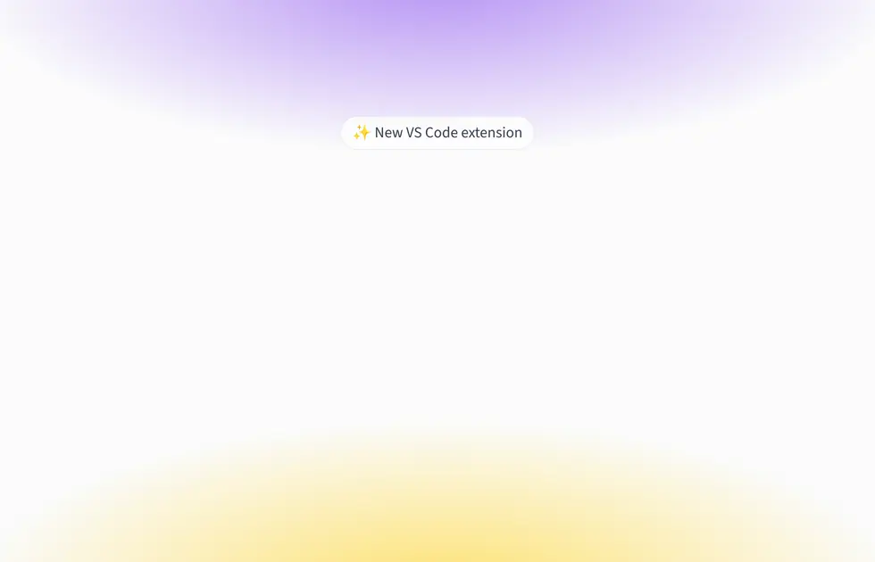

# Copilot Traces for Hugging Face

<p align="center">
  <a href="media/demo.mp4"></a>
</p>

Save your **GitHub Copilot Chat** sessions from VS Code as agent traces and upload them to a
Hugging Face **dataset** or **storage bucket**, where they open in the Hub's
[agent trace viewer](https://huggingface.co/docs/hub/en/agent-traces).

Sessions are converted to the Hub's
[Session Trace Simple Format (STS-Format)](https://huggingface.co/docs/hub/en/session-traces-format):
one `session` header line followed by `user`, `assistant` (with reasoning and tool calls) and
`tool` result messages.

## Features

- Finds every Copilot chat session VS Code has stored: per workspace and in empty windows,
  in both the old `.json` format and the newer `.jsonl` operation-log format.
- Agent mode: rebuilds the actual model ↔ tool loop (each tool-call round, its arguments,
  the tool results and the model's reasoning) from the metadata Copilot saves.
- Ask/Edit mode and other chat participants: rebuilt from the rendered response
  (markdown, thinking, tool invocations, edited files).
- Uploads to `datasets/<user>/<name>` or `buckets/<user>/<name>`, which is created as **private**
  by default if it doesn't exist yet.
- Best-effort **redaction** before anything leaves your machine: common API keys and tokens,
  private keys and `password=`-style assignments, your home directory (→ `~`) and OS username,
  plus any custom regexes you add.
- **[TruffleHog](https://github.com/trufflesecurity/trufflehog) secret scan** (as used by
  [pi-share-hf](https://github.com/badlogic/pi-share-hf)): if `trufflehog` is installed, every trace
  is scanned with its 800+ detectors before upload or export. Secrets it finds are replaced with
  `[REDACTED_TRUFFLEHOG_<DETECTOR>]`; sessions where that isn't possible are held back.
- **Preview** a converted trace in an editor before uploading, or **export** traces to a folder.
- Optional **auto upload** of new or changed sessions on an interval.

## Commands

All commands are under **Copilot Traces:** in the Command Palette.

| Command | What it does |
| --- | --- |
| Preview Session as Trace | Converts one session and opens the JSONL so you can review it |
| Export Sessions to Folder… | Writes selected sessions as `.jsonl` trace files |
| Upload Sessions to Hugging Face… | Pick sessions and upload them |
| Scan Sessions for Secrets with TruffleHog… | Run TruffleHog on selected sessions and report findings |
| Upload All Sessions of This Workspace | Uploads every session of the open workspace |
| Upload All Sessions (All Workspaces) | Uploads every session found |
| Set Upload Target (Dataset or Bucket)… | Change where traces go |
| Open Upload Target in Browser | Opens the dataset/bucket on huggingface.co |
| Set Hugging Face Token… / Remove Hugging Face Token | Manage the token (stored in VS Code SecretStorage) |

If no token is stored, the extension also uses `HF_TOKEN` or the token saved by `hf auth login`.
The token needs **write** access.

## Settings

| Setting | Default | |
| --- | --- | --- |
| `copilotTraces.target` | – | `datasets/<user>/<name>` or `buckets/<user>/<name>` |
| `copilotTraces.visibility` | `private` | Visibility when the repo/bucket has to be created |
| `copilotTraces.pathInRepo` | `copilot` | Folder inside the repo; files are `<folder>/<sessionId>.jsonl`, so re-uploads overwrite |
| `copilotTraces.harness` | `vscode-copilot` | `harness` id in the trace header |
| `copilotTraces.includeWorkspaceName` | `true` | Put the workspace folder name in the header |
| `copilotTraces.maxToolResultChars` | `50000` | Truncate huge tool outputs (0 = off) |
| `copilotTraces.redact.secrets` | `true` | Redact common secrets |
| `copilotTraces.redact.homeDirectory` | `true` | Replace home dir with `~` and username with `<user>` |
| `copilotTraces.redact.customPatterns` | `[]` | Extra regexes to redact |
| `copilotTraces.trufflehog.mode` | `auto` | `auto`: scan when TruffleHog is installed · `required`: refuse to share without a scan · `off` |
| `copilotTraces.trufflehog.onFindings` | `redact` | `redact` found secrets, or `skip` (hold back) the whole session |
| `copilotTraces.trufflehog.verify` | `false` | Let TruffleHog check whether secrets are live (sends them to the issuing service) |
| `copilotTraces.trufflehog.path` | – | Path to `trufflehog` if it isn't on your PATH |
| `copilotTraces.confirmBeforeUpload` | `true` | Confirmation dialog for manual uploads |
| `copilotTraces.autoUpload.enabled` | `false` | Upload new/changed sessions periodically (after a target was set once) |
| `copilotTraces.autoUpload.intervalMinutes` | `30` | |
| `copilotTraces.autoUpload.scope` | `workspace` | `workspace` or `all` |
| `copilotTraces.additionalUserDataDirs` | `[]` | Other VS Code `User` dirs to scan, e.g. Insiders |
| `copilotTraces.hubUrl` | – | Custom Hub endpoint |

## Output format

```jsonl
{"type":"session","harness":"vscode-copilot","id":"5f0c…","name":"Fix the failing test","agent":"GitHub Copilot","source":"vscode-chat","createdAt":"…","models":["gpt-5"],"mode":"agent","workspace":"my-project"}
{"type":"message","message":{"role":"user","content":"Fix the failing test in utils.ts","timestamp":1764000000000}}
{"type":"message","message":{"role":"assistant","content":"I will look at the file first.","reasoningContent":"…","toolCalls":[{"id":"call_read","type":"function","function":{"name":"copilot_readFile","arguments":"{\"filePath\":\"~/proj/utils.ts\"}"}}],"model":"gpt-5"}}
{"type":"message","message":{"role":"tool","toolCallId":"call_read","name":"copilot_readFile","content":"export const add = …"}}
{"type":"message","message":{"role":"assistant","content":"Fixed it.","model":"gpt-5"}}
```

## Privacy

Traces can include prompts, code, file paths, terminal output and secrets. Redaction is
best-effort: preview traces before making a dataset public, and keep it private when unsure.

For a much stronger secret check, install TruffleHog; the extension picks it up automatically:

```bash
brew install trufflehog
```

(or grab a binary from the [releases page](https://github.com/trufflesecurity/trufflehog/releases)).
Set `copilotTraces.trufflehog.mode` to `required` to make sure nothing is shared unscanned.
If TruffleHog reports a *verified* (live) secret, rotate it, even though it won't be uploaded.

## Development

```bash
npm install
npm test          # unit tests (converter, log replay, redaction)
npm run package   # typecheck, bundle and build the .vsix
```

Install the `.vsix` with **Extensions: Install from VSIX…** or
`code --install-extension copilot-traces-hf-0.1.0.vsix`.

## Acknowledgements

- [pi-share-hf](https://github.com/badlogic/pi-share-hf) by [Mario Zechner](https://github.com/badlogic),
  which collects, redacts and uploads Pi agent sessions to Hugging Face. The TruffleHog scan here
  follows its approach (`trufflehog filesystem --json` over the already-redacted traces, then acting
  on the findings).
- [TruffleHog](https://github.com/trufflesecurity/trufflehog) by Truffle Security for secret detection.
- The Hugging Face [agent traces](https://huggingface.co/docs/hub/en/agent-traces) docs and the
  [Session Traces Format](https://huggingface.co/docs/hub/en/session-traces-format).
